# Paquete MoveIt generado con el MoveIt Setup Assistant

Paquete resultante: [`src/ur5_robotiq_moveit_config`](../src/ur5_robotiq_moveit_config) ·
Video de los pasos: [03_setup_assistant_pasos.mp4](../media/videos/03_setup_assistant_pasos.mp4)

Se siguió la guía `MoveitSetupAssConfig.md` del repositorio base usando la
interfaz gráfica (`ros2 launch moveit_setup_assistant setup_assistant.launch.py`).
La salida **sin modificar** del asistente está en el commit
*"Agrega ur5_robotiq_moveit_config tal como lo generó el MoveIt Setup Assistant"*;
las correcciones posteriores están en un commit aparte (ver [hallazgos H8–H9](hallazgos.md)).

| Paso | Configuración | Captura |
|------|---------------|---------|
| 1. Start Screen | *Create New*, `ur5_robotiq_description/urdf/ur_with_gripper_moveit.urdf.xacro` | 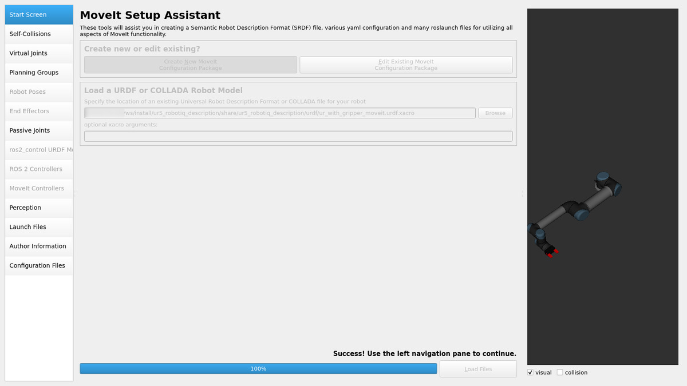 |
| 2. Self-Collisions | densidad por defecto, *Generate Collision Matrix* → 19 pares deshabilitados (adyacentes / nunca en colisión) | 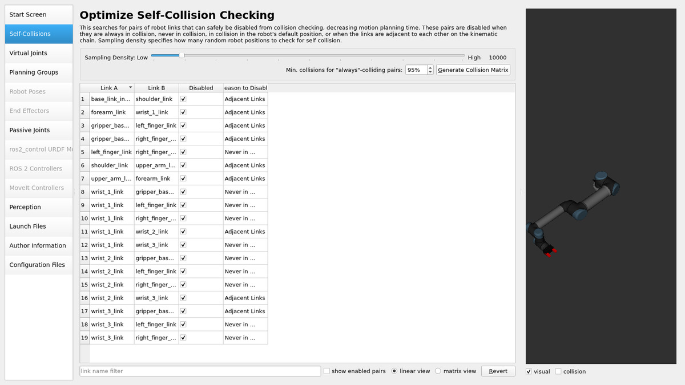 |
| 3. Virtual Joints | No se agregó: el URDF ya fija `world → base_link_parent` ([H6](hallazgos.md)) | 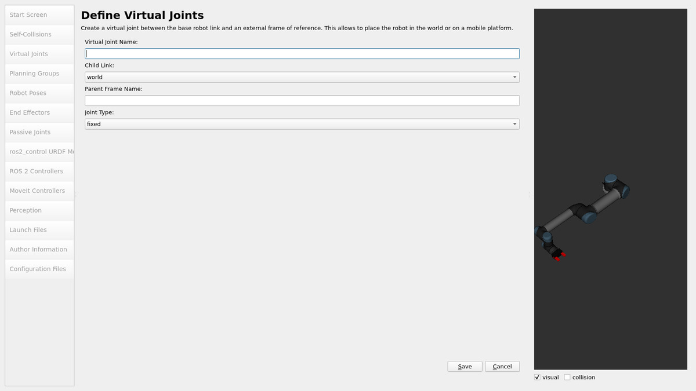 |
| 4. Planning Groups | `ur_arm`: KDL, RRTConnect, 6 articulaciones · `gripper`: sin solver, `gripper_finger_joint`, `right_finger_joint` | 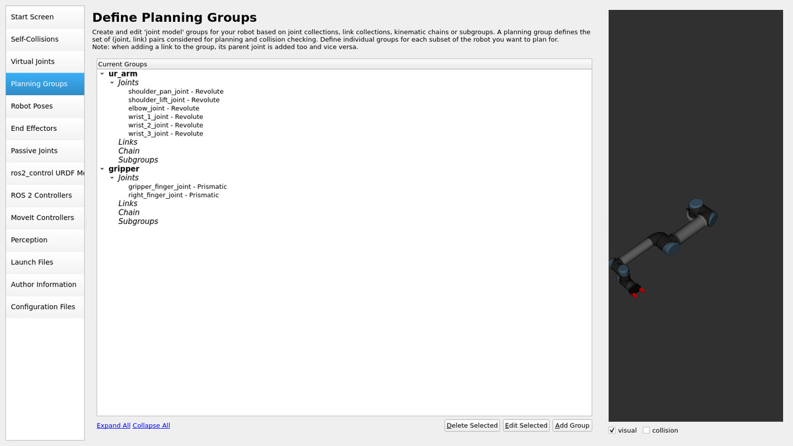 |
| 5. Robot Poses | `home` y `ready` (ur_arm), `open` 0.04/0.04 y `close` 0.004/0.004 (gripper) | 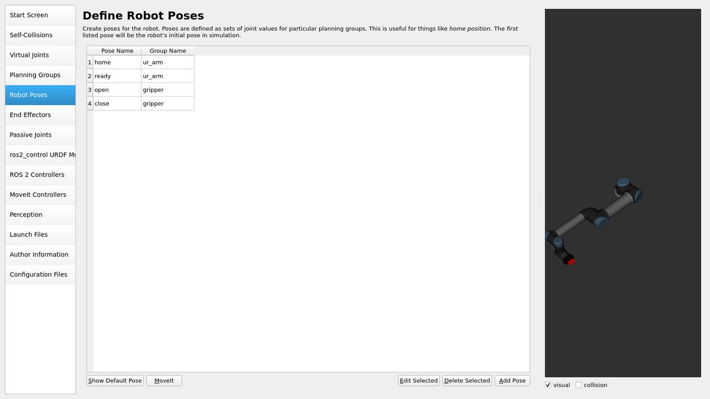 |
| 6. End Effectors | `arm_eef`, grupo `gripper`, parent link `tool0`, parent group vacío ([H7](hallazgos.md)) | 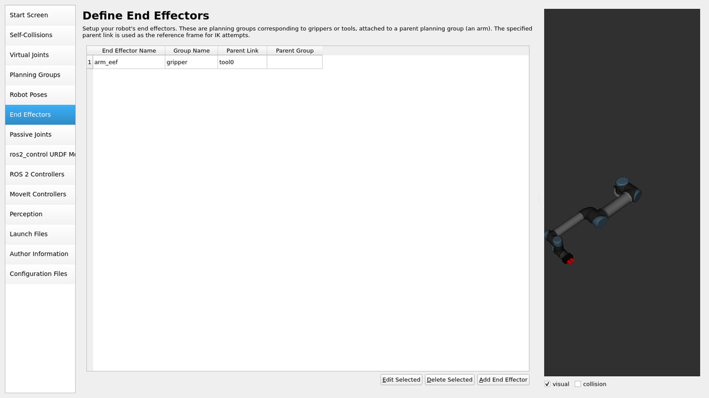 |
| 7. ros2_control URDF | command: position · state: position, velocity | 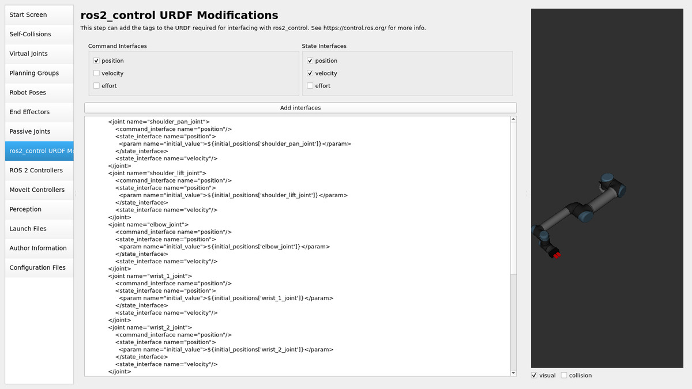 |
| 8. ROS 2 Controllers | `scaled_joint_trajectory_controller` (JointTrajectoryController, ur_arm) · `gripper_controller` (GripperActionController, gripper) | 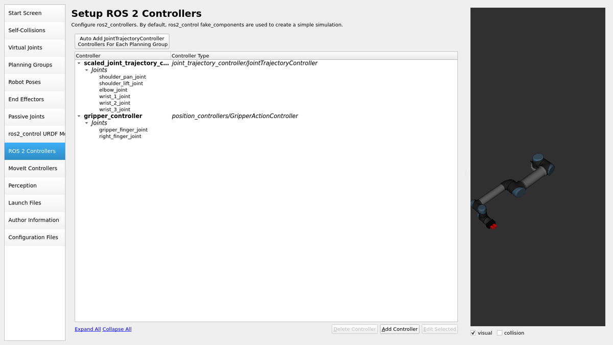 |
| 9. MoveIt Controllers | `scaled_joint_trajectory_controller` FollowJointTrajectory (default) · `gripper_controller` GripperCommand (no default) | 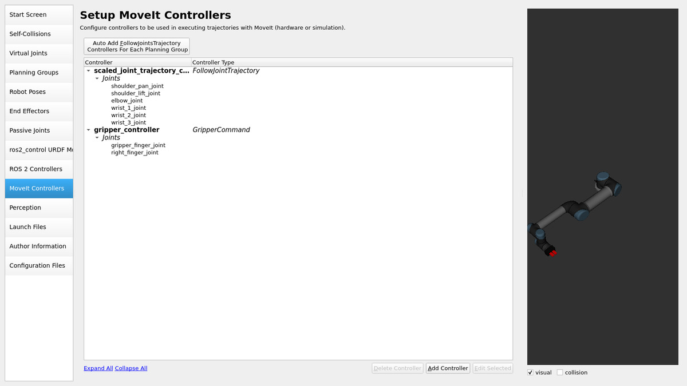 |
| 10. Author Information | Santiago Chacón, Daniela Molina, Tomás | 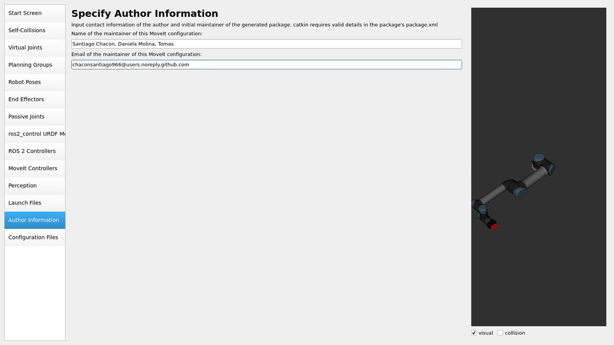 |
| 11. Configuration Files | salida `src/ur5_robotiq_moveit_config` | 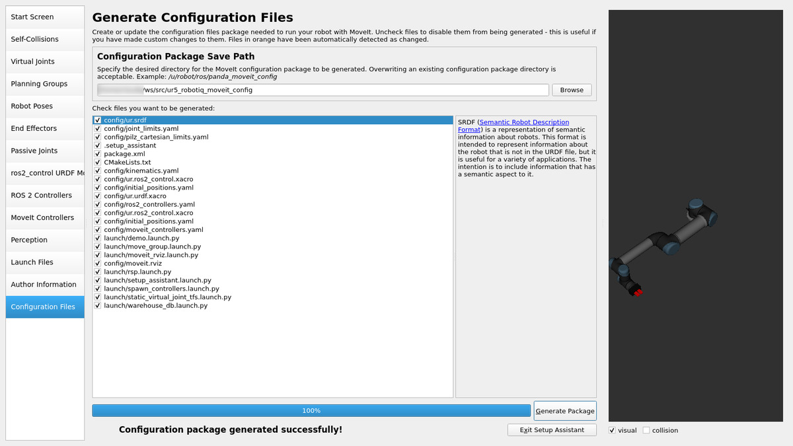 |

## Archivos generados

| Archivo | Contenido |
|---------|-----------|
| `config/ur.srdf` | grupos, estados con nombre, end effector y matriz de colisiones deshabilitadas |
| `config/kinematics.yaml` | `ur_arm` → `kdl_kinematics_plugin/KDLKinematicsPlugin` |
| `config/joint_limits.yaml` | límites de velocidad/aceleración (corregido, H8) |
| `config/ros2_controllers.yaml` | controladores de `ros2_control` para el sistema simulado (`mock_components`) |
| `config/moveit_controllers.yaml` | controladores que usa MoveIt para ejecutar |
| `config/ur.urdf.xacro`, `config/ur.ros2_control.xacro`, `config/initial_positions.yaml` | URDF + `ros2_control` simulado para el demo |
| `launch/demo.launch.py` | RViz + `move_group` + `ros2_control` simulado |

## Pruebas en RViz

`ros2 launch ur5_robotiq_moveit_config demo.launch.py`

Video: [04_moveit_rviz_planificacion.mp4](../media/videos/04_moveit_rviz_planificacion.mp4)

1. Grupo `ur_arm`, meta `ready` → *Plan* (0.04 s) → *Execute* → `SUCCEEDED`.
2. Grupo `ur_arm`, meta `<random valid>` → *Plan & Execute* → `SUCCEEDED`.
3. Grupo `ur_arm`, meta `home` → *Plan & Execute* → `SUCCEEDED`.
4. Grupo `gripper`, metas `close` / `open` → *Plan & Execute* → `SUCCEEDED` (acción `gripper_controller/gripper_cmd`).

Antes de corregir `joint_limits.yaml` todas las planificaciones del brazo
fallaban en `AddTimeOptimalParameterization` (video
[04a_moveit_rviz_error_aceleracion.mp4](../media/videos/04a_moveit_rviz_error_aceleracion.mp4)).
